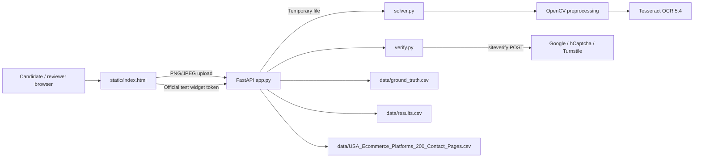

# Architecture and cost notes

## Scope

The application is a local assessment demo. The supported OCR workflow uses generated images and known ground truth. The provider workflow renders official public test widgets in the local UI and sends acquired test tokens from the backend to the provider's official verification endpoint. The supplied ecommerce CSV is only read as structured metadata. No listed site is fetched, automated, or sent a form submission.

## Components

### OCR workflow

1. The browser uploads a PNG or JPEG. The API accepts at most 5 MB and validates the actual image format before decoding it.
2. FastAPI saves the upload to a temporary file and runs the OCR operation in a worker thread.
3. OpenCV creates grayscale, Otsu threshold, inverted, morphology-open, and adaptive-threshold variants; the image is enlarged before OCR.
4. Tesseract runs with a fixed five-character alphabet and page-segmentation mode 7. Candidate selection prefers a five-character answer, then uses Tesseract confidence as a tie-breaker.
5. Single-image `success` means a five-character candidate was produced. The solver cannot know if it is correct without ground truth. `/api/batch` computes exact-match accuracy against the current labels and refreshes `data/results.csv`.

The current local batch measured 40 exact matches out of 50 (80%) and took approximately 141 seconds. The generator is random, so this is a measurement for the committed ground-truth sample, not a guaranteed score on regenerated images. The original PSM 8 baseline recorded in the assessment notes was 30/50 (60%). OCR confidence can be zero and is not calibrated as probability.

### Provider verification workflow

1. The UI loads public widget sitekeys from `GET /api/providers`; the endpoint never returns secret keys.
2. The candidate completes a Google reCAPTCHA v2, hCaptcha, or Turnstile **test** widget. The browser retains the resulting token in memory.
3. The UI sends the token and provider name to `POST /api/verify` over the local app connection.
4. `verify.py` sends a URL-encoded request to the selected provider's official `siteverify` API with the server-side test secret and a timeout.
5. The API returns the provider result, normalized error name, provider error codes, hostname/timestamp when available, and elapsed time. It does not log or echo the token or secret.

Observed manual checks in the assessment environment: Turnstile accepted a public test token (hostname `example.com`); an hCaptcha nonsense token returned `invalid_token`; an unavailable Google endpoint returned `verification_unavailable` on `ConnectTimeout`; empty token and unknown provider returned structured `missing_token` and `unsupported_provider` results. Google's public reCAPTCHA v2 test key accepts any token, so it cannot demonstrate a rejection case. These test keys are not production anti-bot protection.

### Detection and reporting

- `detector.py` identifies provider markers in an HTML string supplied by the user. It does not fetch URLs or inspect dynamically rendered page content.
- `/api/csv-stats` reads the supplied CSV and aggregates the `Captcha` and `Platform` columns. It performs no network requests.
- `/api/stats` keeps counters in process memory. It distinguishes image candidate output, provider acceptance, and exact-match batch results by workflow. Counters reset when the server restarts.

## Configuration and data handling

- `.env.example` contains only the providers' public test secrets. A developer may copy it to `.env`; `.env` is ignored by Git.
- Provider sitekeys are public and sent to the browser. Provider secrets remain server-side.
- Uploaded images are capped at 5 MB, checked by Pillow, written to a temporary file, and deleted after processing.
- Generated images under `data/synthetic/` and batch output `data/results.csv` are ignored by Git. `captcha_generator.py` recreates the images and `data/ground_truth.csv` labels before a fresh evaluation.
- The project never contacts the company URLs contained in the supplied CSV.

## Cost breakdown

| Component | Used in this project | Estimated assessment cost |
|---|---|---:|
| Tesseract OCR 5.4.0 | Local OCR engine | $0 |
| Python, FastAPI, Pillow, OpenCV, pytesseract, requests | Local application dependencies | $0 |
| Google reCAPTCHA test keys | Official test widget and verification | $0 |
| hCaptcha test keys | Official test widget and verification | $0 |
| Cloudflare Turnstile test keys | Official test widget and verification | $0 |
| 2Captcha or another paid solving API | Not implemented; no API calls or account required | $0 in this assessment |
| **Total for the demonstrated assessment workflows** | | **$0** |

Paid CAPTCHA-solving services such as 2Captcha are outside the implemented workflow. No price is claimed for them because this project neither selects nor purchases a paid service. Any future integration would need its own authorization, pricing, data-handling review, configuration, error handling, and measured cost per challenge.

## Main source files

| File | Responsibility |
|---|---|
| `app.py` | FastAPI routes, upload validation, batch evaluation, CSV aggregation, and session metrics |
| `solver.py` | OpenCV preprocessing and Tesseract candidate selection |
| `detector.py` | Static HTML provider-marker and challenge-type recognition |
| `verify.py` | Public test-key configuration and provider `siteverify` requests |
| `captcha_generator.py` | Candidate-controlled synthetic image and ground-truth generation |
| `static/index.html` | Local responsive UI and provider test widgets |
